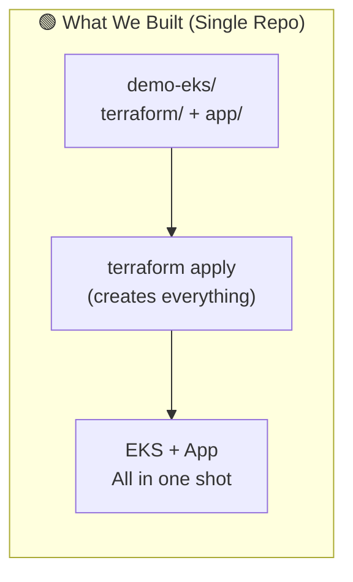
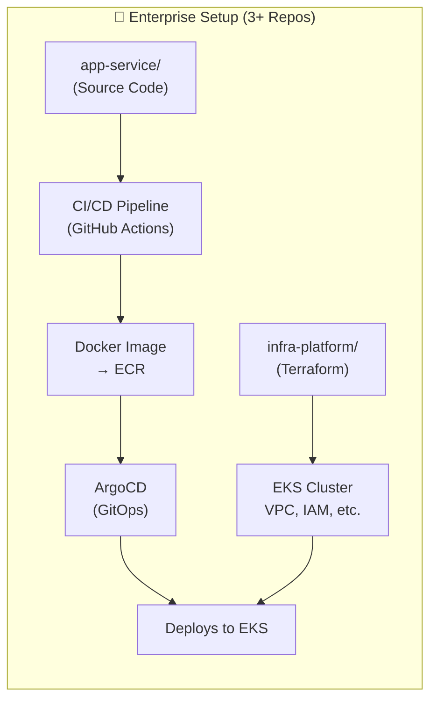
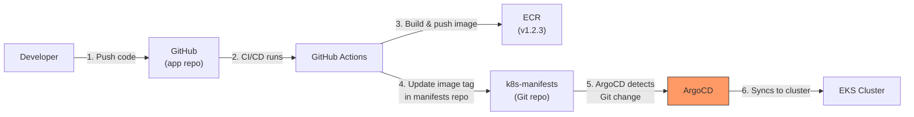
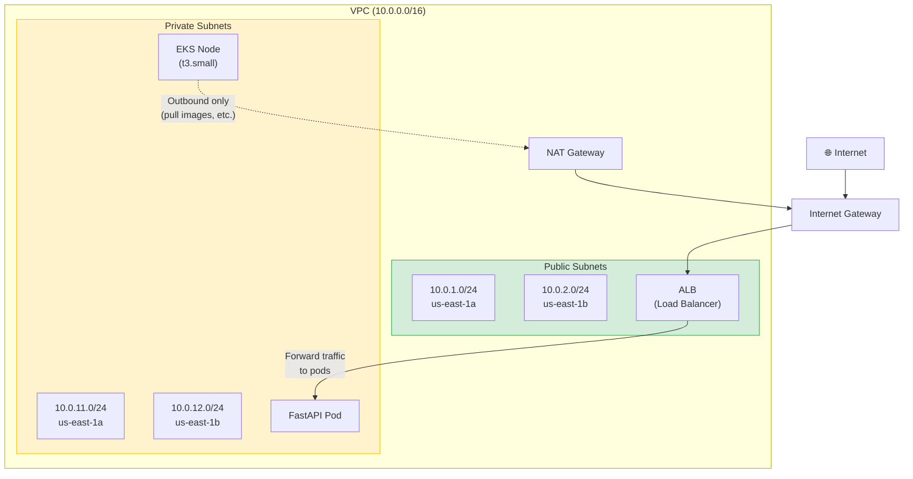
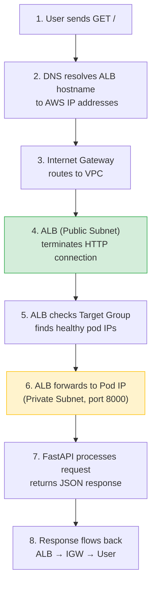

# 🏗️ Infrastructure Deep Dive — What We Built & How Enterprises Do It

## Table of Contents
1. [Our Setup vs Enterprise Setup](#our-setup-vs-enterprise-setup)
2. [Why Separate Projects?](#why-separate-projects)
3. [What is ArgoCD & GitOps?](#what-is-argocd--gitops)
4. [Public vs Private Subnets — Why Both?](#public-vs-private-subnets--why-both)
5. [Full Infrastructure Map — Every Component Explained](#full-infrastructure-map)

---

## Our Setup vs Enterprise Setup





| Aspect | Our Setup | Enterprise Setup |
|--------|-----------|-----------------|
| **Repos** | 1 repo (everything) | 3+ repos (infra, app, k8s manifests) |
| **Who creates the cluster?** | You, the developer | Platform/DevOps team |
| **Who deploys the app?** | `terraform apply` | ArgoCD (automatic from Git) |
| **How images get deployed** | Terraform references ECR image | CI/CD builds image → updates manifest → ArgoCD syncs |
| **State management** | Local `.tfstate` file | Remote S3 + DynamoDB lock |
| **Environments** | Just one | dev → staging → prod |

---

## Why Separate Projects?

Enterprises split into separate repos/projects for good reasons:

### Repo 1: `infra-platform` (Terraform)
**Owned by: Platform / DevOps team**

```
infra-platform/
├── modules/
│   ├── vpc/
│   ├── eks/
│   ├── rds/
│   └── monitoring/
├── environments/
│   ├── dev/
│   ├── staging/
│   └── prod/
└── README.md
```

This creates the **foundation** — VPC, EKS cluster, databases, monitoring. It changes **rarely** (maybe monthly). You don't want an app developer accidentally destroying the production cluster.

> [!IMPORTANT]
> **Key insight**: The cluster is treated like a "building" — the platform team builds and maintains the building. App teams are "tenants" who deploy their apps inside it.

### Repo 2: `my-service` (Application Source Code)
**Owned by: Application / Feature team**

```
my-service/
├── src/
│   └── main.py
├── tests/
├── Dockerfile
├── .github/workflows/
│   └── ci.yml          # Build → Test → Push image to ECR
└── k8s/
    ├── deployment.yaml
    ├── service.yaml
    └── ingress.yaml
```

This changes **frequently** (every PR, multiple times a day). The CI/CD pipeline:
1. Runs tests
2. Builds Docker image
3. Pushes to ECR
4. Updates the image tag in the K8s manifests

### Repo 3: `k8s-manifests` (GitOps — sometimes inside Repo 2)
**Watched by: ArgoCD**

```
k8s-manifests/
├── apps/
│   ├── my-service/
│   │   ├── deployment.yaml    # image: my-service:v1.2.3
│   │   ├── service.yaml
│   │   └── ingress.yaml
│   ├── another-service/
│   └── ...
└── base/
    └── namespace.yaml
```

### Why separate them?

| Reason | Explanation |
|--------|-------------|
| **Blast radius** | A bad Terraform change doesn't affect running apps. A bad app deploy doesn't destroy infrastructure. |
| **Permissions** | Platform team has infra access. App devs only have app repo access. Nobody accidentally runs `terraform destroy` on prod. |
| **Change frequency** | Infra changes monthly. Apps change daily. Different review/approval processes. |
| **Team ownership** | Clear boundaries. Platform team owns the cluster. App teams own their services. |
| **Compliance** | Auditors want to see who changed infrastructure vs who changed application code. |

---

## What is ArgoCD & GitOps?

### The Problem ArgoCD Solves

In **our setup**, deploying looks like this:
```
Developer → docker build → docker push → terraform apply → cluster updated
```

This is **imperative** — you're telling the system *what to do*, step by step, from your laptop. Problems:
- What if your laptop dies mid-deploy?
- What if two people deploy at the same time?
- What's the "source of truth" for what's running?
- How do you roll back?

### GitOps: Git Is the Source of Truth



### How ArgoCD Works

ArgoCD runs **inside** the EKS cluster and continuously watches a Git repo:

```
Every 3 minutes:
  1. ArgoCD checks: "What does Git say should be running?"
  2. ArgoCD checks: "What IS actually running in the cluster?"
  3. If different → ArgoCD syncs the cluster to match Git
```

> [!TIP]
> Think of ArgoCD like a thermostat. You set the desired temperature (Git), and the thermostat (ArgoCD) constantly adjusts to match. If someone manually changes something in the cluster, ArgoCD reverts it back to what Git says.

### Why Enterprises Love ArgoCD

| Benefit | How |
|---------|-----|
| **Rollback** | Just `git revert` → ArgoCD auto-deploys the previous version |
| **Audit trail** | Every deployment is a Git commit with author, timestamp, review |
| **Self-healing** | Someone `kubectl delete` a pod config? ArgoCD puts it back |
| **Multi-env promotion** | Merge to `dev` branch → deploys to dev. Merge to `main` → deploys to prod |
| **No kubectl access needed** | Developers never touch the cluster directly |

### Where ArgoCD Would Fit in Our Project

If we added ArgoCD, our setup would change:

```
BEFORE (what we have):
  terraform apply → creates cluster AND deploys app

AFTER (with ArgoCD):
  Repo 1: terraform apply → creates cluster + installs ArgoCD
  Repo 2: developer pushes code → CI builds image → updates manifests
  ArgoCD: detects manifest change → deploys to cluster automatically
```

---

## Public vs Private Subnets — Why Both?

This is one of the most important networking concepts in cloud architecture.

### What Are They?



### Public Subnet
- **Has a route to the Internet Gateway** → resources here get public IPs and can be reached from the internet
- **What lives here**: ALB (Load Balancer), NAT Gateway, Bastion hosts
- **Analogy**: The lobby of a building — anyone can walk in

### Private Subnet
- **No direct route to the internet** → resources here are NOT reachable from the internet
- **Outbound access only** via NAT Gateway (e.g., to pull Docker images from ECR)
- **What lives here**: EKS nodes, databases, application pods, internal services
- **Analogy**: The offices inside the building — you need to go through the lobby

### Why Not Just Put Everything in Public Subnets?

| Risk | Explanation |
|------|-------------|
| **Attack surface** | Every public resource is a potential target. Your app pods don't need to be directly reachable. |
| **Compliance** | PCI-DSS, HIPAA, SOC2 all require sensitive workloads to be in private networks. |
| **Defense in depth** | Even if someone compromises the ALB, they still can't directly reach your pods' host machine. |
| **Principle of least privilege** | Only expose what MUST be exposed (the load balancer). Everything else stays hidden. |

### The Traffic Flow

```
User's browser
  → Internet
    → Internet Gateway
      → ALB (in PUBLIC subnet — this is the only thing exposed)
        → Pod (in PRIVATE subnet — hidden from internet)
          → Response flows back the same path
```

When your pod needs to reach the internet (e.g., pull an image):
```
Pod (PRIVATE subnet)
  → NAT Gateway (in PUBLIC subnet — translates private IP to public)
    → Internet Gateway
      → Internet (e.g., ECR to pull Docker images)
```

> [!NOTE]
> The NAT Gateway is why we can run nodes in private subnets but still pull images from ECR. It allows **outbound** traffic but blocks **inbound** traffic from the internet. It costs ~\$0.045/hr — this is a real cost factor.

### Why Two of Each Subnet?

We created 2 public + 2 private subnets across **two Availability Zones** (us-east-1a and us-east-1b):

- **ALB requires at least 2 AZs** — AWS mandates this for load balancers
- **High availability** — if one data center (AZ) goes down, the other keeps running
- Even with 1 node, the networking is ready to scale to multiple nodes across AZs

---

## Full Infrastructure Map

Here is **every single AWS resource** that Terraform created, and why:

### Networking Layer (VPC)

| Resource | What It Is | Why We Need It |
|----------|-----------|----------------|
| **VPC** | Virtual Private Cloud — your own isolated network in AWS | Everything must live in a VPC. It's your private data center in the cloud. |
| **Internet Gateway** | Connects your VPC to the public internet | Without this, nothing in your VPC can reach or be reached from the internet. |
| **NAT Gateway** | Allows private subnet resources to access the internet (outbound only) | EKS nodes need to pull container images from ECR and communicate with AWS APIs. |
| **Elastic IP** | Static public IP attached to the NAT Gateway | NAT Gateway needs a fixed public IP for outbound traffic. |
| **Public Subnets (×2)** | Network segments with internet access | ALB and NAT Gateway live here. |
| **Private Subnets (×2)** | Network segments WITHOUT internet access | EKS worker nodes and pods live here (secure). |
| **Route Tables** | Rules that determine where network traffic goes | Public subnets route to IGW. Private subnets route to NAT. |
| **Subnet-Route Table Associations** | Link each subnet to its route table | Tell each subnet which routing rules to follow. |

### Security Layer

| Resource | What It Is | Why We Need It |
|----------|-----------|----------------|
| **EKS Cluster Security Group** | Firewall rules for the EKS control plane | Controls what can talk to the Kubernetes API server. |
| **Node Security Group** | Firewall rules for worker nodes | Allows pods to communicate with each other and the control plane. |
| **Security Group Rules** | Individual allow/deny rules | Opens specific ports: 443 (API), 8443/9443 (webhooks), 10250 (kubelet), etc. |

### EKS Layer

| Resource | What It Is | Why We Need It |
|----------|-----------|----------------|
| **EKS Cluster** | Managed Kubernetes control plane | AWS runs the K8s API server, etcd, scheduler, controller-manager for you. This is the \$0.10/hr cost. |
| **EKS Managed Node Group** | Group of EC2 instances that run your pods | The actual compute (t3.small) where your containers run. |
| **Launch Template** | Template defining how worker nodes are configured | Specifies instance type, AMI, security groups, user data for node startup. |
| **OIDC Provider** | OpenID Connect identity provider for the cluster | Enables IAM Roles for Service Accounts (IRSA) — lets pods assume IAM roles securely. |
| **KMS Key** | Encryption key | Encrypts Kubernetes secrets at rest in etcd. |
| **CloudWatch Log Group** | Stores cluster logs | EKS control plane logs (API, audit, controller) for debugging. |
| **IAM Roles & Policies** | Permission sets | Cluster role (manage AWS resources), Node role (pull images, join cluster), LB controller role. |
| **EKS Access Entry** | Grants your IAM user cluster admin | So your `kubectl` commands work against the cluster. |

### Load Balancing Layer

| Resource | What It Is | Why We Need It |
|----------|-----------|----------------|
| **AWS LB Controller** (Helm chart) | Kubernetes controller that creates ALBs | Watches for Ingress resources and automatically creates/configures AWS ALBs. |
| **IRSA Role for LB Controller** | IAM role assumed by the LB controller pod | Gives the controller permission to create/manage ALBs, target groups, etc. |
| **ALB** (created by controller) | Application Load Balancer | Receives HTTP traffic from the internet and routes it to your pods. |
| **Target Group** (created by controller) | Group of pod IPs | ALB forwards traffic to these pod IPs (target-type: IP). |

### Application Layer (Kubernetes)

| Resource | What It Is | Why We Need It |
|----------|-----------|----------------|
| **Namespace** (`demo-eks`) | Logical grouping within the cluster | Isolates our app's resources from system components. |
| **Deployment** | Manages pod lifecycle | Ensures 1 replica of our FastAPI app is always running. Handles rolling updates. |
| **Pod** | Running container instance | Your actual FastAPI app, running uvicorn on port 8000. |
| **Service** (ClusterIP) | Internal load balancer / DNS | Gives pods a stable internal DNS name (`demo-eks-svc.demo-eks.svc.cluster.local`). |
| **Ingress** | Routing rules for external traffic | Tells the ALB controller: "create an ALB that routes `/` to my service on port 80". |

### Container Registry

| Resource | What It Is | Why We Need It |
|----------|-----------|----------------|
| **ECR Repository** | Private Docker image registry | Stores your built container images. Nodes pull from here when starting pods. |

---

### How It All Connects — Full Request Flow



> [!TIP]
> **Total resource count**: Terraform created ~40+ AWS resources for this "simple" deployment. This is why infrastructure-as-code matters — imagine creating all of this manually in the AWS console, and then trying to tear it all down without missing anything!
